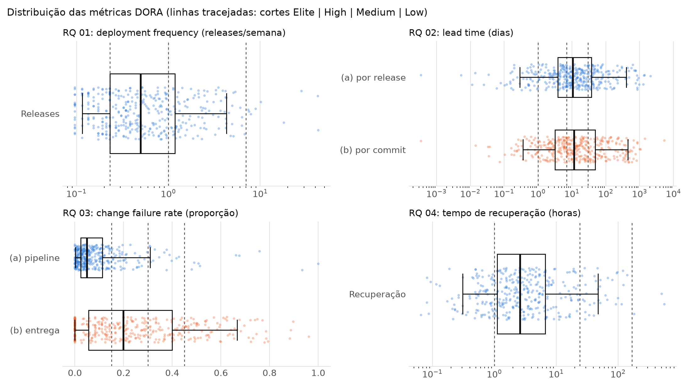
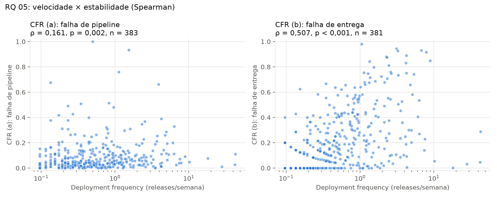
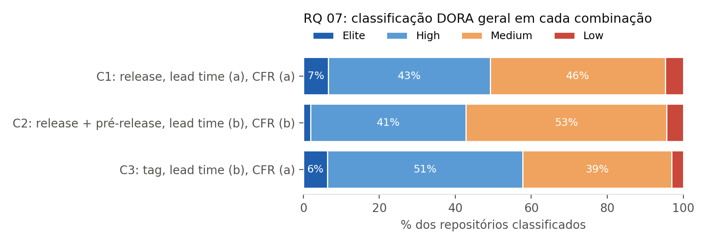
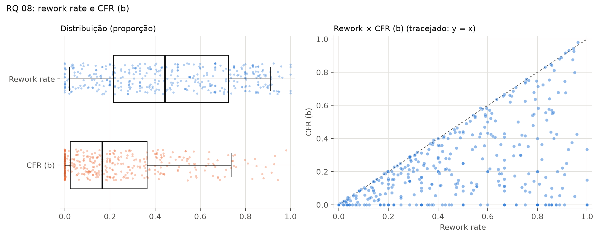

# Mineração de Métricas DORA em Repositórios Open Source

## Resumo

Este trabalho mede as métricas DORA em 383 repositórios open source populares que usam GitHub Actions, a partir de proxies: releases publicadas no lugar de deploys e execuções de CI no lugar de falhas em produção. Os dados foram coletados por um pipeline próprio e reprodutível, numa janela de 12 meses. O repositório típico publica uma release a cada duas semanas, tem lead time de cerca de 11 dias e recupera o pipeline em menos de 3 horas. A idade do repositório é a característica mais associada ao desempenho, e a popularidade não mostrou associação. A análise de sensibilidade mostra que de 21% a 27% dos repositórios mudam de categoria DORA quando a definição operacional muda, e que as conclusões sobre estabilidade dependem do proxy de falha escolhido.

## 1. Introdução

As métricas DORA são usadas para avaliar velocidade e estabilidade na entrega de software. Entretanto, repositórios open source não registram diretamente todos os eventos necessários, como deploys em produção e falhas de produção. Portanto, este estudo utiliza releases publicadas como proxy de deploy e workflow runs do GitHub Actions como proxy de execução de CI.

O objetivo inicial é construir um pipeline reprodutível que permita coletar os dados, calcular as métricas e avaliar as limitações dessas aproximações.

## 2. Hipóteses iniciais

- **RQ 01:** repositórios populares que usam CI/CD apresentarão frequências de release diferentes entre si, com concentração em poucos projetos mais ativos.
- **RQ 02:** o lead time por commit será menor e menos sensível a commits antigos do que o lead time por release.
- **RQ 03:** a taxa de falha do proxy de CI não será equivalente à taxa de falha de entrega, pois os conceitos medidos são diferentes.
- **RQ 04:** parte dos episódios de falha permanecerá censurada ao final da janela de observação.
- **RQ 05:** espera-se uma relação fraca ou inexistente entre frequência de deploy e taxa de falha.
- **RQ 06:** popularidade, idade, número de contribuidores e linguagem poderão estar associados a diferenças nas métricas DORA.
- **RQ 07:** as classificações dos repositórios poderão mudar conforme a definição operacional utilizada.

## 3. Metodologia

### 3.1 Fonte de dados e seleção dos repositórios

Os dados vêm da API REST do GitHub e, no caso das tags, da API GraphQL. A coleta é feita por um cliente próprio, escrito só com a biblioteca padrão do Python, sem bibliotecas prontas de acesso ao GitHub. A execução completa (coleta e geração do dataset) é feita por um único comando: `python -m pipeline --config config.toml`.

Os candidatos vêm de `GET /search/repositories` com `stars:>=1000 archived:false fork:false`, em ordem decrescente de estrelas. Como a busca devolve no máximo 1.000 resultados por consulta, ela é fatiada por faixas de estrelas: cada nova consulta começa na menor contagem vista na anterior. Repositórios arquivados e forks ficam de fora já na consulta, porque os primeiros não recebem mudanças e os segundos repetem o histórico do original.

Os candidatos são avaliados em lotes de 100, na ordem da busca. Cada um passa por uma triagem da etapa mais barata para a mais cara e é descartado na primeira em que falhar: (1) uso de GitHub Actions (`total_count > 0` em `/actions/workflows`); (2) pelo menos 5 releases estáveis publicadas na janela; (3) pelo menos 50 workflow runs válidos de `push` no default branch na janela. Só os aprovados seguem para a coleta completa (compare entre releases, tags e contribuidores). A coleta para ao fim do primeiro lote em que a amostra passa de 350 elegíveis. O guia exige no mínimo 300, e a folga cobre repositórios que depois ficassem sem alguma métrica. Como a decisão de parar só é tomada com o lote inteiro concluído, o paralelismo da coleta não muda quais repositórios entram na amostra.

**Tabela 1. Funil de seleção.**

| Etapa | Critério | Restantes | Descartados | Motivo do descarte |
|---|---|---:|---:|---|
| Candidatos | ≥ 1.000 estrelas, não arquivado, não fork | 900 | | |
| Com Actions | ao menos um workflow | 817 | 83 | não usa GitHub Actions |
| Releases | ≥ 5 releases estáveis na janela | 441 | 376 | poucas releases |
| Amostra final | ≥ 50 workflow runs válidos na janela | **383** | 58 | poucos runs válidos |

O maior corte acontece no critério de releases: 376 dos 817 repositórios com Actions (46,0%) não publicaram 5 releases estáveis em 12 meses. Boa parte deles são listas, tutoriais e projetos que versionam só por tags, para os quais "release" não faz sentido como unidade de entrega.

A coleta final foi feita em 15/10/2026, com cerca de 90 mil chamadas à API e 5h46 de execução efetiva. O volume coletado para os 383 repositórios é de **27.571 releases estáveis**, 7.364 pré-releases, 52.880 tags, **1.213.308 workflow runs válidos** (109.375 com falha) de 11.067 workflows e 3.077.084 commits usados no lead time.

### 3.2 Janela de observação e escopo

A janela vai de **02/10/2025 a 01/10/2026** (365 dias, ≈ 52,1 semanas), com todos os limites em UTC. O guia diz que a janela é fixada na abertura do Lab03S01. Como o grupo não encontrou a data oficial, adotou os 12 meses que terminam na abertura da sprint (02/10/2026). Só entram releases publicadas e workflow runs criados dentro dessa janela. A única exceção é a release estável anterior à primeira release da janela, que pode estar fora dela e serve de base para o compare do lead time.

Todas as consultas consideram apenas o *default branch* informado pela API (`default_branch`).

### 3.3 Definições operacionais

**Tabela 2. Definições operacionais usadas na combinação de referência (C1).**

| Conceito | Definição operacional |
|---|---|
| Deploy | Release publicada, com `draft = false` e `prerelease = false`, ordenada por `published_at` |
| Data de um commit | `commit.author.date` |
| Commits de uma release R | `compare/{release estável anterior}...{R}`, paginado com `per_page=100` |
| Execução de CI | Workflow run do default branch com `event = push` |
| Falha / sucesso de CI | `failure`, `timed_out` e `startup_failure` são falha; `success` é sucesso; os demais valores de `conclusion` (inclusive vazio) são ignorados |
| Deployment frequency (RQ 01) | Releases estáveis na janela ÷ 52,1 semanas |
| Lead time (a), por release (RQ 02) | Data de R − data do commit mais antigo de R; mediana entre as releases do repositório |
| Lead time (b), por commit (RQ 02) | Data de R − data de cada commit de R; mediana de todos os commits do repositório |
| CFR (a), proxy de CI (RQ 03) | Runs com falha ÷ (falhas + sucessos), com todos os workflows juntos |
| CFR (b), proxy de entrega (RQ 03) | Releases cuja próxima release estável **da mesma linha MAJOR.MINOR** sai em até 7 dias e é corretiva ÷ releases avaliadas |
| Release corretiva (heurística v6, seção 4.4) | A versão é um patch da própria linha (PATCH > 0, como 2.3.1 ou 8.4.15) **e** as release notes têm pelo menos tantos termos de correção (`fix`, `bug`, `hotfix`, `regression`, `crash`, `security`...) quanto de funcionalidade (`feature`, `new`, `added`, `improvement`...). Fora do SemVer: mais termos de correção que de funcionalidade |
| Tempo de recuperação (RQ 04) | Dentro de cada workflow, em ordem de `run_started_at`: `updated_at` do próximo sucesso − `run_started_at` da primeira falha do episódio; mediana dos episódios do repositório |

Duas regras de censura evitam descartar casos que deixariam os repositórios com aparência melhor do que têm:

- **CFR (b):** releases publicadas nos últimos 7 dias da janela não têm como ser avaliadas e saem do denominador. Foram 1.306 releases (4,74%), de 161 repositórios.
- **Tempo de recuperação:** um episódio sem sucesso até o fim da janela fica censurado. Foram 382 de 36.785 episódios (1,04%). A proporção censurada é registrada por repositório (`recovery_censored_ratio`).

A primeira release da história de um repositório não tem base de comparação e fica fora do lead time (70 releases). Releases cujo compare devolveu 404 (tag apagada ou reescrita) também ficam de fora e são contadas por repositório (6 releases no total).

### 3.4 Variantes e classificação DORA

Para a análise de sensibilidade (RQ 07), as métricas são recalculadas em três combinações de definições operacionais:

**Tabela 3. Combinações de definições operacionais.**

| Combinação | Unidade de deploy | Lead time | CFR | Coluna de frequência no dataset |
|---|---|---|---|---|
| C1 (referência) | release estável | (a) | (a) | `deployment_frequency` |
| C2 | release + pré-release | (b) | (b) | `deployment_frequency_with_pre` |
| C3 | tag | (b) | (a) | `deployment_frequency_tags` |

Na C2, o compare de cada release é feito contra a release anterior de qualquer tipo. Dos 383 repositórios, 162 publicaram ao menos uma pré-release na janela; nas demais, C1 e C2 diferem só nas variantes de lead time e CFR. Na C3, a data de cada tag é a data do commit apontado (`authoredDate` via GraphQL), como pede o guia. O lead time por tag não foi coletado, porque exigiria um compare por par de tags. Por isso a C3 usa o lead time (b) das releases e muda só a unidade da frequência de deploy. O tempo de recuperação é o mesmo nas três combinações.

Em cada combinação, cada métrica é classificada em Elite, High, Medium ou Low pelos cortes fixos da disciplina. A categoria geral é a mediana das quatro notas (Elite = 4, High = 3, Medium = 2, Low = 1), arredondada para baixo. Repositórios sem alguma das quatro métricas ficam sem categoria geral.

### 3.5 Limites da coleta

Três limites da API e da cota foram tratados com cortes explícitos, todos registrados no dataset:

- **Workflow runs:** a API devolve no máximo 1.000 resultados por consulta filtrada. A janela foi dividida em meses, mas os meses que ainda passavam do teto não foram subdivididos, porque um único repositório muito ativo exigiria mais de mil chamadas só de runs. Nesses meses entram os 1.000 runs mais recentes. Isso aconteceu em **96 repositórios** (coluna `runs_capped_days`).
- **Commits por release:** o compare foi limitado a 2.000 commits (20 páginas). **719 releases (2,6%)** passaram disso. Como o compare lista os commits do mais antigo para o mais recente, o lead time (a) continua correto; o (b) perde os commits mais recentes dessas releases e tende a ser levemente superestimado.
- **Releases por repositório:** a paginação para ao alcançar a primeira release estável anterior à janela, com teto de 30 páginas (3.000 releases).

As respostas da API ficam em um cache SQLite, gravado a cada resposta, e uma coleta interrompida continua de onde parou. O cliente respeita `X-RateLimit-Remaining`/`X-RateLimit-Reset`, repete erros 5xx e de rede com backoff exponencial (1 s, 2 s, 4 s, ...) e alterna entre vários tokens. As funções de cálculo das métricas têm testes com *fixtures* e rodam no GitHub Actions a cada push. Os detalhes de cada decisão estão em `docs/decisoes-metodologicas.md` e cada coluna dos CSVs está descrita em `docs/dicionario-de-dados.md`.

### 3.6 Análise estatística

Como as distribuições são muito assimétricas, cada métrica é resumida por mediana e IQR. A RQ 05 usa a correlação de Spearman. A RQ 06 usa Kruskal-Wallis (ou Mann-Whitney, quando o fator tem dois grupos), com correção de Holm para comparações múltiplas e tamanho de efeito por ε² e Cliff's delta. A RQ 07 usa a proporção de repositórios que mudam de categoria e o kappa de Cohen com ponderação linear. O nível de significância é α = 0,05 em todos os testes.

## 4. Validação manual (amostra-ouro)

### 4.1 Amostra

Foram sorteados **60 repositórios** da amostra final e **5 releases estáveis** de cada um, num total de 300 releases. O sorteio usa `random.Random(42)`, com a semente em `config.toml`, e pode ser refeito a partir do dataset. Cada avaliador recebe uma cópia da mesma planilha, com links para o repositório, para a página da release e para o compare com a release anterior. Três das 300 releases são a primeira release do repositório e não têm compare; nelas, o avaliador decide só pelas *release notes*.

### 4.2 Rotulação

Cada avaliador preencheu três dimensões:

**Tabela 4. Dimensões rotuladas.**

| Dimensão | Nível | Valores | Critério |
|---|---|---|---|
| Tipo do projeto | repositório (60) | biblioteca/framework, aplicação/serviço, ferramenta CLI, outro | Pelo README: se é importado por outro código, executado ou implantado pelo usuário final, usado na linha de comando, ou nenhum desses |
| Entrega real | repositório (60) | sim, não, incerto | Se as releases levam software utilizável ao usuário (binários, pacotes, versões instaláveis) |
| Release corretiva | release (300) | sim, não | Se o **objetivo principal** da release é corrigir um defeito recente, pelas *release notes* e pela lista de commits |

A rotulação foi independente: cada avaliador trabalhou sozinho, sem ver a planilha do colega e sem ver a saída da heurística. Para isso, o grupo usou uma ferramenta própria (`python -m analysis.rotular`) que abre os links de cada linha e grava a resposta digitada, lendo só a planilha do próprio avaliador.

**Dois avaliadores, e não três.** O guia prevê três avaliadores, mas o grupo tem dois integrantes. Isso tem três consequências. Primeiro, não existe maioria: qualquer divergência vai para a reunião de desempate. Segundo, o kappa de Fleiss continua definido com dois avaliadores (nesse caso ele coincide com o π de Scott), mas a estimativa fica menos estável do que seria com três. Terceiro, o rótulo de consenso depende da discussão entre só duas pessoas, o que é registrado como ameaça à validade.

### 4.3 Concordância e consenso

A concordância é medida pelo **kappa de Fleiss** em cada dimensão, sobre os rótulos independentes (antes do consenso), e interpretada pela escala de Landis e Koch (1977).

**Tabela 5. Concordância entre os avaliadores, sobre os rótulos independentes.**

| Dimensão | Itens | Concordância | κ de Fleiss | Landis e Koch |
|---|---:|---:|---:|---|
| Tipo do projeto | 60 | 91,7% | 0,875 | quase perfeita |
| Releases são entregas reais | 60 | 95,0% | −0,026 | pobre |
| Release corretiva | 300 | 74,0% | 0,477 | moderada |

O **tipo do projeto** tem concordância quase perfeita: o README costuma deixar claro se o projeto é uma biblioteca, uma aplicação ou uma ferramenta de linha de comando.

A **entrega real** mostra o paradoxo do kappa (Feinstein e Cicchetti, 1990), em que a concordância é alta e o kappa é baixo.
- Quase todos os rótulos são "sim" (117 de 120), então dois avaliadores que respondessem "sim" quase sempre já concordariam em 95,1% dos casos por acaso.
- O kappa mede a concordância acima do acaso, e por isso fica perto de zero.
- As três divergências foram de um avaliador marcando "não" e o outro "sim". Os dois nunca concordaram num "não".

O resultado não indica um critério ambíguo. Indica uma dimensão que quase não varia na amostra: para os dois avaliadores, as releases de praticamente todos os repositórios levam software utilizável ao usuário. Isso dá algum apoio ao uso de releases como proxy de entrega nesta amostra.

A **release corretiva** tem concordância só moderada.
- Os avaliadores divergiram em uma de cada quatro releases: um marcou 151 das 300 como corretivas, e o outro, 127.
- Decidir se o objetivo *principal* de uma release é corrigir um defeito exige interpretar notas de versão que costumam misturar correções, melhorias e manutenção.
- Se duas pessoas discordam nesse ponto, não se pode esperar que uma regra automática acerte muito mais. Esse é o teto prático da heurística avaliada na seção 4.4.

Houve **86 divergências**: 78 de release corretiva, 5 de tipo do projeto e 3 de entrega real.
- **O que o protocolo previa:** discutir cada caso relendo as *release notes* e os commits.
- **O que foi feito:** na reunião de desempate, os avaliadores concluíram que um deles tinha aplicado o critério de forma mais consistente, e o rótulo desse avaliador foi adotado em todas as divergências, sem revisão caso a caso. A decisão está registrada em `data/gold/divergencias.csv` e em `docs/protocolo-rotulagem.md`.
- **Consequência:** nos 78 casos divergentes de release corretiva (26% das 300 releases), o consenso equivale ao julgamento de um único avaliador. Isso é tratado como ameaça à validade de construto.

### 4.4 Avaliação da heurística

A heurística de release corretiva é comparada com o rótulo de consenso por precisão, recall e F1, com `sim` como classe positiva.
- **Releases avaliadas:** 297. As outras 3 são a primeira release do repositório e não têm com o que ser comparadas.
- **Positivos:** o consenso marca 127 delas (42,8%) como corretivas.
- **Meta:** F1 ≥ 0,70. Abaixo disso, a heurística é refinada a partir dos erros e reavaliada, e cada versão testada fica registrada com o seu F1.

**Tabela 6. Versões da heurística de release corretiva frente ao consenso (n = 297).**

| Versão | Regra | Precisão | Recall | F1 |
|---|---|---:|---:|---:|
| v1 (versão inicial) | só o PATCH muda **e** há commit de correção | 0,591 | 0,614 | 0,602 |
| v2 | há commit de correção | 0,430 | 0,898 | 0,582 |
| v3 | só o PATCH muda | 0,605 | 0,701 | 0,650 |
| v4 | só o PATCH muda **ou** há commit de correção | 0,442 | 0,984 | 0,610 |
| v5 | é patch da própria linha (PATCH > 0) | 0,590 | 0,929 | 0,722 |
| **v6 (adotada)** | patch da própria linha **e** notas com termos de correção ≥ termos de funcionalidade | **0,728** | **0,843** | **0,781** |
| v7 | patch da própria linha **e** há commit de correção | 0,611 | 0,843 | 0,709 |

*Commit de correção: mensagem com `fix`, `fixes`, `fixed`, `bugfix`, `hotfix` ou `revert`. Nas versões v1 a v4, "só o PATCH muda" compara a release com a anterior **por data**; nas v5 a v7, olha só a própria versão. Para tags fora do SemVer, a v1 usa só o commit.*

**Nenhuma das quatro primeiras versões atinge a meta.** Os erros mostram por quê:
- **O commit de correção quase não discrimina.** 265 das 297 releases (89,2%) têm ao menos um commit com essas palavras, porque quase toda release reúne alguma correção, ainda que pequena. Por isso as versões que dependem só dele (v2) ou que o aceitam como alternativa (v4) têm recall alto e precisão baixa.
- **O PATCH é o sinal mais informativo, mas não basta.** A v3 tem o melhor F1 (0,650). A v1, que exige as duas condições, perde recall sem ganhar precisão.

**O refinamento.** A análise dos falsos negativos da v3 mostrou que a maior parte eram **releases de manutenção de linhas antigas**: por exemplo, `php-8.4.15` publicada depois da 8.5, `v8.19.9` do Elasticsearch publicada depois da 9.x, ou a `v3.19.3` do Nuxt publicada depois da 4.1. Comparadas com a release anterior **por data**, que é de outra linha, elas parecem mudanças de MINOR ou MAJOR. Três versões novas foram testadas a partir desse achado:

- **v5:** basta a versão ser um patch da própria linha (PATCH > 0). Só essa mudança leva o F1 a 0,722, com recall de 0,929.
- **v6:** v5 **e** release notes com pelo menos tantos termos de correção quanto de funcionalidade. As notas filtram as releases de patch que trazem principalmente novidades e elevam a precisão para 0,728, com **F1 = 0,781**.
- **v7:** v5 **e** commit de correção. Fica em 0,709: o commit de correção continua quase não discriminando.

A **v6 foi adotada** e passou a ser usada no CFR (b), no rework rate e na combinação C2. Como a regra foi escolhida olhando a mesma amostra em que é avaliada, a robustez foi conferida em 200 divisões aleatórias dos 60 repositórios em duas metades: a v6 fica com F1 ≥ 0,70 em 98% das metades (mediana de 0,781), contra 3% da v1. O mesmo achado levou a um ajuste no CFR (b): a release que corrige R passa a ser a próxima **da mesma linha** MAJOR.MINOR, e não a próxima por data, que em repositórios com várias linhas pode ser um backport sem relação com R.

O F1 de 0,781 é coerente com o teto dado pela própria concordância humana (κ = 0,477, seção 4.3). A heurística erra 15,0% das 220 releases em que os avaliadores concordaram, mas 35,1% das 77 em que divergiram: os casos difíceis para as pessoas também são difíceis para a regra.

O tipo do projeto definido no consenso é usado como fator na RQ 06.

## 5. Resultados

Esta seção apresenta os resultados das RQs 01 a 05 sobre a amostra final de **383 repositórios**, na janela de 02/10/2025 a 01/10/2026. Seguindo o enunciado, cada métrica é resumida pela mediana e pelo intervalo interquartil (IQR, de Q1 a Q3), pois as distribuições são muito assimétricas. A classificação DORA usa os cortes fixos da disciplina na combinação de referência **C1**: release estável, lead time (a), CFR (a) e tempo de recuperação. Todas as tabelas e figuras são regeneradas a partir de `data/processed/repositories_metrics.csv` por `python -m analysis.descritivas` e `python -m analysis.correlacoes`.

**Tabela 7. Mediana e IQR das métricas DORA (RQs 01 a 04).**

| RQ | Métrica | Unidade | n | Mediana | Q1 | Q3 | IQR |
|---|---|---|---:|---:|---:|---:|---:|
| RQ 01 | Deployment frequency | releases/semana | 383 | 0,50 | 0,23 | 1,18 | 0,95 |
| RQ 02 | Lead time (a): por release | dias | 383 | 10,67 | 3,82 | 38,11 | 34,29 |
| RQ 02 | Lead time (b): por commit | dias | 383 | 11,72 | 3,17 | 48,93 | 45,76 |
| RQ 03 | CFR (a): falha de pipeline | proporção | 383 | 0,049 | 0,023 | 0,113 | 0,089 |
| RQ 03 | CFR (b): falha de entrega | proporção | 381 | 0,167 | 0,024 | 0,364 | 0,340 |
| RQ 04 | Tempo de recuperação | horas | 364 | 2,63 | 1,11 | 6,68 | 5,56 |

**Tabela 8. Classificação DORA na combinação C1 (% sobre os repositórios classificados).**

| Métrica | n | Elite | High | Medium | Low |
|---|---:|---:|---:|---:|---:|
| Deployment frequency | 383 | 9 (2,3%) | 98 (25,6%) | 176 (46,0%) | 100 (26,1%) |
| Lead time (a) | 383 | 50 (13,1%) | 97 (25,3%) | 122 (31,9%) | 114 (29,8%) |
| CFR (a) | 383 | 316 (82,5%) | 44 (11,5%) | 14 (3,7%) | 9 (2,3%) |
| Tempo de recuperação | 364 | 82 (22,5%) | 246 (67,6%) | 33 (9,1%) | 3 (0,8%) |
| **Geral** | 364 | 24 (6,6%) | 155 (42,6%) | 168 (46,2%) | 17 (4,7%) |

*Figura 1. Distribuição das métricas das RQs 01 a 04. Caixas: Q1, mediana e Q3; bigodes: percentis 5 e 95; pontos: repositórios; linhas tracejadas: cortes da classificação DORA. Eixos em escala logarítmica, exceto o do CFR.*

### 5.1 RQ 01: frequência de deploy

O repositório típico publica **0,50 release estável por semana**, cerca de uma release a cada duas semanas (IQR de 0,23 a 1,18). Apenas 27,9% dos repositórios publicam ao menos uma release por semana, e só 9 (2,3%) alcançam a faixa Elite (≥ 7 por semana). A faixa mais comum é Medium (46,0%), seguida de Low (26,1%), isto é, menos de uma release por mês.

A distribuição tem cauda longa à direita (Figura 1): os 10% mais ativos (38 repositórios) concentram **57,0% de todas as releases** da amostra, e o maior valor (`ggml-org/llama.cpp`, 42,9 releases por semana) é mais de 80 vezes a mediana. Isso confirma a hipótese de que a frequência varia muito entre os projetos e se concentra em poucos repositórios.

### 5.2 RQ 02: lead time das mudanças

As duas variantes têm medianas próximas: **10,67 dias** na variante (a), por release, e **11,72 dias** na variante (b), por commit. A dispersão, porém, é diferente. A variante (b) tem IQR maior (45,76 contra 34,29 dias) e cauda superior mais pesada: o percentil 90 é de 266 dias, contra 135 dias na (a).

A comparação par a par mostra por que as variantes divergem:

- **Dentro de uma release**, a variante (a) é sempre a maior, porque usa o commit mais antigo. Um único commit "esquecido" faz o lead time daquela release explodir. Por isso, em **60,6%** dos repositórios a variante (a) supera a (b), e a mediana da razão (a)/(b) é 1,27.
- **No agregado do repositório**, a ponderação é diferente. A variante (a) dá o mesmo peso a cada release, enquanto a (b) dá peso a cada commit. Em projetos que alternam releases pequenas e frequentes com releases grandes que acumulam meses de trabalho, as releases grandes dominam a variante (b) e puxam sua mediana para cima. Esse efeito explica os 39,2% de repositórios em que (b) > (a).

A hipótese de que a variante (b) seria menor e menos sensível a commits antigos se confirma, portanto, só parcialmente. Ela vale para a maioria dos repositórios, mas a variante (b) é mais sensível ao tamanho das releases. Na classificação C1, que usa a variante (a), o lead time é a métrica mais espalhada entre as faixas: 13,1% Elite, 25,3% High, 31,9% Medium e 29,8% Low. Uma ressalva: 719 releases (2,6%) tinham mais de 2.000 commits, e só os 2.000 mais antigos foram coletados.

### 5.3 RQ 03: taxa de falha das mudanças

As duas variantes de CFR medem coisas diferentes e produzem valores bem diferentes:

- **CFR (a), falha de pipeline:** mediana de **4,9%** (IQR de 2,3% a 11,3%). Com esse valor, 82,5% dos repositórios caem na faixa Elite (≤ 15%), o que torna o CFR (a) a métrica menos discriminante de C1.
- **CFR (b), falha de entrega:** mediana de **16,7%** (IQR de 2,4% a 36,4%), mais de três vezes a do CFR (a) e com dispersão quase quatro vezes maior. Com essa variante, só 48,0% dos repositórios seriam Elite. Além disso, 87 repositórios (22,8%) não tiveram nenhuma release seguida de correção em até 7 dias (CFR (b) = 0).

A correlação de Spearman entre as variantes é fraca: ρ = 0,138 (p = 0,007, n = 381). Um repositório com pipeline instável não tende a ser o mesmo que publica releases corretivas, o que confirma a hipótese de que as variantes não são equivalentes. O CFR (a) registra qualquer falha de CI no default branch, inclusive testes instáveis (*flaky*) e falhas de lint corrigidas em minutos, que nunca chegam ao usuário. Já o CFR (b) se aproxima mais da definição DORA, mas depende da heurística de release corretiva, validada contra a amostra-ouro na seção 4.4.

> *Os valores do CFR (b) nesta seção, na 5.5, na 5.7 e na 5.8 ainda foram calculados com a heurística v1 (F1 = 0,602). Eles serão atualizados com a v6 (F1 = 0,781) após o recálculo do dataset (#22).*

Por censura, **1.306 das 27.571 releases (4,74%)**, de 161 repositórios, ficaram fora do denominador do CFR (b) por terem sido publicadas nos últimos 7 dias da janela. Dois repositórios ficaram sem CFR (b) porque todas as suas releases caíram nesse período: `expo/expo`, com 267 releases entre 29/09 e 01/10/2026, e `Alishahryar1/free-claude-code`. No caso do `expo/expo`, a verificação mostrou que não se trata de erro de coleta: o projeto, um monorepo, só passou a publicar releases no GitHub em 29/09/2026, e publica uma release por pacote. Isso também infla a sua deployment frequency (5,1 por semana) e é um exemplo extremo de release que não equivale a deploy.

### 5.4 RQ 04: tempo de recuperação

A mediana do tempo de recuperação é de **2,63 horas** (IQR de 1,11 a 6,68 horas). A grande maioria dos repositórios recupera o pipeline no mesmo dia: 67,6% estão na faixa High (de 1 hora a menos de 1 dia) e 22,5% na Elite (menos de 1 hora). Apenas 36 (9,9%) levam um dia ou mais, e só 3 repositórios (0,8%) passam de uma semana.

Dos 36.785 episódios de falha, **382 (1,04%) foram censurados**, isto é, não tiveram recuperação até o fim da janela. Eles aparecem em 168 dos 367 repositórios com episódios, mas a mediana da proporção censurada por repositório é 0%. A hipótese de que haveria censura se confirma, mas em escala pequena. Dezenove repositórios ficaram sem tempo de recuperação: 16 não tiveram nenhum episódio de falha na janela e 3 tiveram apenas episódios censurados. Por isso, a classificação geral de C1 cobre 364 repositórios.

**Classificação geral (C1).** Combinando as quatro métricas, a amostra se divide em 6,6% Elite, 42,6% High, 46,2% Medium e 4,7% Low. O CFR (a) e o tempo de recuperação, ambos medidos sobre o CI, puxam a classificação para cima. A frequência de deploy e o lead time, medidos sobre releases, puxam para baixo.

### 5.5 RQ 05: velocidade × estabilidade

**Tabela 9. Correlação de Spearman entre deployment frequency e CFR.**

| Variante do CFR | n | ρ | p-valor | Interpretação (α = 0,05) |
|---|---:|---:|---:|---|
| (a) falha de pipeline | 383 | 0,161 | 0,002 | fraca positiva, significativa |
| (b) falha de entrega | 381 | 0,507 | < 0,001 | moderada positiva, significativa |

*Figura 2. Dispersão entre deployment frequency (eixo x em escala logarítmica) e CFR nas variantes (a) e (b).*

Nas duas variantes, a correlação é **positiva**: repositórios que publicam mais releases também tendem a falhar mais. A intensidade, porém, depende da definição. Com o CFR (a), a relação é fraca (ρ = 0,161), o que está de acordo com a hipótese de relação fraca ou inexistente. Com o CFR (b), a relação é moderada (ρ = 0,507) e contraria a hipótese.

Parte dessa diferença pode ser um artefato da própria definição operacional. O CFR (b) só marca uma release como falha se a próxima sair em até 7 dias, e repositórios que publicam várias releases por semana têm, por construção, mais oportunidades de cumprir essa condição. Assim, o CFR (b) não é independente da frequência de deploy. Com esses proxies, os dados não sustentam a afirmação do DORA de que velocidade e estabilidade não competem entre si. Ainda assim, trata-se de correlação, e não de causalidade, e o efeito do proxy deve ser aprofundado na Discussão.

### 5.6 RQ 06: características associadas ao desempenho

Foram usados cinco fatores: linguagem principal, estrelas, contribuidores, idade do repositório e tipo do projeto.
- **Estrelas, contribuidores e idade** foram divididos pelos quartis da amostra (Q1 = 25% menores).
- **Linguagem:** as cinco linguagens com pelo menos 30 repositórios (TypeScript, Python, Go, Rust e JavaScript) formam grupos próprios, e as demais foram reunidas em "Outras" (71 repositórios), para não haver grupos com dois ou três repositórios.
- **Tipo do projeto:** vem do rótulo de consenso da amostra-ouro (seção 4) e, por isso, cobre só os 60 repositórios sorteados: 25 aplicações, 18 bibliotecas, 14 ferramentas CLI e 3 "outro".

Com 5 fatores e as 4 métricas de C1, são **20 testes de Kruskal-Wallis**, com p-valores corrigidos por Holm numa única família. Resultados gerados por `python -m analysis.fatores`.

**Tabela 10. Tamanho de efeito ε² e p-valor corrigido por Holm (entre parênteses) de cada fator × métrica.**

| Fator | Deployment frequency | Lead time (a) | CFR (a) | Tempo de recuperação |
|---|---:|---:|---:|---:|
| Linguagem principal | **0,058** (0,008) | **0,096** (< 0,001) | 0,033 (0,388) | 0,020 (1,000) |
| Estrelas (quartis) | 0,018 (0,986) | 0,005 (1,000) | 0,004 (1,000) | 0,018 (0,986) |
| Contribuidores (quartis) | 0,007 (1,000) | **0,151** (< 0,001) | 0,008 (1,000) | 0,009 (1,000) |
| Idade (quartis) | **0,092** (< 0,001) | **0,317** (< 0,001) | 0,021 (0,621) | **0,049** (0,008) |
| Tipo do projeto (n = 60) | 0,012 (1,000) | 0,079 (1,000) | 0,044 (1,000) | 0,085 (1,000) |

*Em negrito, os testes significativos (α = 0,05 após Holm). Escala usual de ε²: < 0,01 desprezível; < 0,08 pequeno; < 0,26 médio; ≥ 0,26 grande.*

*Figura 3. Tamanho de efeito ε² de cada fator × métrica; o asterisco marca os testes significativos após a correção de Holm.*

Seis dos 20 testes são significativos. O fator mais forte é a **idade**. Os repositórios mais novos (Q1, menos de 2,6 anos) têm mediana de lead time (a) de **2,9 dias**, contra **42,3 dias** nos mais antigos (Q4, mais de 10,6 anos). O efeito é grande (ε² = 0,317; Cliff's δ entre Q4 e Q1 = 0,800). Os mais novos também publicam mais (0,88 contra 0,36 release por semana, δ = −0,441) e recuperam o pipeline mais rápido (1,5 contra 3,3 horas, δ = 0,321).

O número de **contribuidores** está associado só ao lead time. O quartil com mais contribuidores (Q4, mais de 948) tem mediana de 32,1 dias, contra 5,5 dias no quartil com menos (Q1, menos de 208), com δ = 0,587 (grande). Nas outras três métricas, os quartis praticamente não diferem.

Na **linguagem**, as diferenças aparecem na frequência de deploy e no lead time. Repositórios em TypeScript publicam mais (mediana de 0,77 release por semana, contra 0,36 a 0,61 nas demais) e, junto com Python e Rust, têm lead time menor (7 a 8 dias) que Go e o grupo "Outras" (cerca de 25 dias). As comparações par a par têm efeito pequeno ou médio (|δ| entre 0,31 e 0,44).

A **popularidade** (estrelas) não tem associação significativa com nenhuma métrica, e seus efeitos são todos desprezíveis ou pequenos (ε² ≤ 0,018). O **CFR (a)** também não difere entre os grupos de nenhum fator. Dois testes de CFR (a) seriam significativos sem a correção (linguagem, p = 0,028, e idade, p = 0,048), mas deixam de ser com Holm. Esse é exatamente o tipo de falso positivo que a correção para comparações múltiplas evita.

O **tipo do projeto** também não tem associação significativa com nenhuma métrica.
- **O que as medianas sugerem:** bibliotecas teriam lead time maior (15,4 dias, contra 9,2 nas aplicações e 12,1 nas ferramentas CLI) e recuperação mais lenta (2,9 horas, contra 1,5 e 1,1). Os efeitos vão de pequeno a médio (ε² de 0,012 a 0,085).
- **Por que isso não basta:** com 60 repositórios, e só 3 no grupo "outro", o teste tem pouco poder para detectar diferenças desse tamanho, e nenhum p corrigido fica abaixo de 1,000. A ausência de significância aqui não é evidência de que o tipo do projeto não importa. Ela mostra que a amostra-ouro é pequena demais para responder a essa pergunta.

### 5.7 RQ 07: sensibilidade à definição operacional

As três combinações da Tabela 3 foram classificadas pelos mesmos cortes da disciplina. Os resultados foram gerados por `python -m analysis.sensibilidade`.

**Tabela 11. Classificação DORA geral em cada combinação.**

| Combinação | n | Elite | High | Medium | Low |
|---|---:|---:|---:|---:|---:|
| C1: release, lead time (a), CFR (a) | 364 | 24 (6,6%) | 155 (42,6%) | 168 (46,2%) | 17 (4,7%) |
| C2: release + pré-release, lead time (b), CFR (b) | 362 | 7 (1,9%) | 148 (40,9%) | 191 (52,8%) | 16 (4,4%) |
| C3: tag, lead time (b), CFR (a) | 364 | 23 (6,3%) | 187 (51,4%) | 143 (39,3%) | 11 (3,0%) |

**Tabela 12. Repositórios que mudam de categoria e kappa de Cohen ponderado (linear) entre as combinações.**

| Métrica | C1 × C2: mudaram | κ | C1 × C3: mudaram | κ | C2 × C3: mudaram | κ |
|---|---:|---:|---:|---:|---:|---:|
| **Geral** | **27,3%** | **0,564** | **20,9%** | **0,700** | **24,6%** | **0,619** |
| Deployment frequency | 11,7% | 0,844 | 25,6% | 0,644 | 14,1% | 0,783 |
| Lead time | 43,9% | 0,553 | 41,0% | 0,590 | 11,2% | 0,873 |
| CFR | 56,4% | 0,034 | 0,0% | 1,000 | 56,4% | 0,034 |

*O tempo de recuperação é o mesmo nas três combinações e não muda. Na C1 × C3, o CFR é o (a) nas duas.*

*Figura 4. Distribuição da classificação geral nas três combinações.*

Entre **um quinto e pouco mais de um quarto** dos repositórios muda de categoria geral quando a definição muda: 27,3% entre C1 e C2, 20,9% entre C1 e C3 e 24,6% entre C2 e C3. Quase todas as mudanças são de um nível só (por exemplo, High → Medium), por isso o kappa ponderado fica entre moderado e substancial (0,564 a 0,700). Só 5 repositórios (1,4%) pularam dois níveis ou mais entre C1 e C2, 2 entre C2 e C3 e nenhum entre C1 e C3.

A direção da mudança depende da combinação. Da C1 para a C2, 66 repositórios pioram e 33 melhoram, e a faixa Elite cai de 6,6% para 1,9%. Da C1 para a C3, 56 melhoram e 20 pioram, porque a frequência medida por tags é sempre maior ou igual à medida por releases (97 repositórios sobem de faixa nessa métrica e só 1 desce).

Olhando métrica por métrica, a mais frágil é o **CFR**. Trocar o proxy de CI pelo proxy de entrega muda a categoria de 56,4% dos repositórios, e o kappa (0,034) indica concordância apenas leve, quase a que se esperaria por acaso. O **lead time** vem em seguida: trocar a variante (a) pela (b) muda 41% a 44% das categorias. A **frequência de deploy** é a mais estável: incluir pré-releases muda 11,7% e trocar releases por tags muda 25,6%.

Uma observação de método: o kappa ponderado depende da ordem das categorias. O `cohen_kappa_score` do scikit-learn, sem o parâmetro `labels`, ordena os rótulos alfabeticamente (Elite, High, Low, Medium), e a ponderação linear passa a tratar Low como vizinho de High. Com essa ordem, o kappa geral de C1 × C2 sairia 0,558, e o do lead time, 0,457 em vez de 0,553. Por isso o cálculo usa explicitamente a ordem Low < Medium < High < Elite.

### 5.8 RQ 08 (bônus): rework rate

O *rework rate* é a proporção de releases corretivas sobre o total de releases estáveis da janela, usando a mesma heurística de release corretiva do CFR (b). Resultados gerados por `python -m analysis.rework` (valores ainda da heurística v1; ver a nota da seção 5.3).

**Tabela 13. Rework rate e CFR (b).**

| Métrica | Definição | n | Mediana | Q1 | Q3 | IQR | Repositórios com valor 0 |
|---|---|---:|---:|---:|---:|---:|---:|
| Rework rate | releases corretivas / releases | 383 | 0,444 | 0,215 | 0,725 | 0,509 | 4,4% |
| CFR (b) | releases seguidas de corretiva em ≤ 7 dias / releases avaliadas | 381 | 0,167 | 0,024 | 0,364 | 0,340 | 22,8% |

*Figura 5. À esquerda, distribuições do rework rate e do CFR (b) (caixas: Q1, mediana e Q3; bigodes: percentis 5 e 95). À direita, dispersão entre as duas métricas; a linha tracejada é y = x.*

No repositório típico, **44,4% das releases são corretivas**, quase três vezes a mediana do CFR (b) (16,7%). As duas métricas estão moderadamente correlacionadas (ρ = 0,484, p < 0,001, n = 381), mas o rework rate supera o CFR (b) em 85,8% dos repositórios e empata em 9,2%. Por isso, quase todos os pontos da Figura 5 ficam abaixo da diagonal.

A diferença vem do que cada métrica conta:

- **O que é contado:** o CFR (b) atribui a falha à release **quebrada**, aquela que foi seguida por uma correção. O rework rate conta as próprias releases **de correção**.
- **Janela de 7 dias:** o CFR (b) só considera correções publicadas em até 7 dias. O rework rate conta qualquer release corretiva, inclusive as que corrigem defeitos antigos ou que vêm depois de um intervalo maior.
- **Sequências de patches:** uma série como 2.3.1 → 2.3.2 → 2.3.3 conta três vezes no rework rate. No CFR (b), cada release só falha se a seguinte sair em até 7 dias.
- **Censura:** o rework rate não precisa observar o que vem depois da release, então não tem censura no fim da janela.

O rework rate mede, portanto, **quanto do esforço de entrega é gasto com retrabalho**, enquanto o CFR (b) mede **quantas entregas precisaram ser corrigidas logo em seguida**. O valor alto do rework rate também reflete que a heurística v1 era ampla, já que quase toda release de patch tem algum commit com `fix`. Com a v6, mais restritiva, espera-se um rework rate menor.

## 6. Discussão

### 6.1 Hipóteses e resultados

**Tabela 14. Hipóteses informais da Introdução e o que os dados mostraram.**

| RQ | Hipótese | Resultado |
|---|---|---|
| 01 | Frequências muito diferentes, concentradas em poucos projetos | **Confirmada.** Os 10% mais ativos concentram 57,0% das releases |
| 02 | Lead time (b) menor e menos sensível a commits antigos | **Parcial.** Vale em 60,6% dos repositórios, mas a variante (b) é mais sensível ao tamanho das releases |
| 03 | CFR (a) e CFR (b) não são equivalentes | **Confirmada.** Medianas de 4,9% e 16,7%, ρ = 0,138 entre elas e κ = 0,034 nas categorias |
| 04 | Parte dos episódios fica censurada | **Confirmada, em escala pequena** (1,04% dos episódios) |
| 05 | Relação fraca ou inexistente entre frequência e falha | **Depende do proxy.** Fraca com o CFR (a) (ρ = 0,161), moderada com o CFR (b) (ρ = 0,507) |
| 06 | Popularidade, idade, contribuidores e linguagem associados ao desempenho | **Parcial.** Idade, contribuidores e linguagem, sim; popularidade, não. O tipo do projeto não teve diferença significativa, mas só cobre 60 repositórios |
| 07 | As categorias podem mudar com a definição | **Confirmada.** 20,9% a 27,3% dos repositórios mudam de categoria geral |

### 6.2 O que surpreendeu

**A popularidade não importa, mas a idade importa muito.** O grupo esperava que repositórios mais populares, com mais gente olhando, tivessem processos de entrega mais maduros. Nenhuma métrica difere entre os quartis de estrelas. Já a idade tem o maior efeito da RQ 06. Uma explicação provável é o ciclo de vida do projeto: repositórios novos estão em fase de crescimento rápido, publicam versões pequenas e frequentes e ainda não têm uma base grande de usuários que exija releases mais espaçadas. Projetos antigos tendem a ter ciclos de release planejados, com várias semanas de mudanças acumuladas em cada versão, o que aumenta o lead time por release.

**Idade e contribuidores andam juntos.** Os dois fatores não são independentes: a correlação de Spearman entre idade e número de contribuidores é ρ = 0,56. Como os dois estão associados ao lead time, não dá para separar o efeito de um e de outro com testes de um fator por vez. É o exemplo de ameaça à validade interna que o enunciado cita ("repositórios mais antigos têm mais releases"), e ela se aplica aqui: parte do efeito atribuído aos contribuidores pode ser efeito da idade, e vice-versa. O mesmo vale para a linguagem. Os repositórios em TypeScript e Python são mais novos (medianas de 6,3 e 3,6 anos) que os em JavaScript e "Outras" (9,9 e 10,7 anos), e uma parte da vantagem dessas linguagens pode vir da idade.

**O CFR (a) quase não discrimina.** Com mediana de 4,9%, 82,5% dos repositórios caem na faixa Elite, e nenhum fator da RQ 06 o diferencia depois da correção. A explicação está no próprio proxy: o CI do default branch roda depois do merge, quando as mudanças já passaram pelos testes do pull request. O que falha nesse ponto é pouco, e falha por motivos que não chegam ao usuário (testes instáveis, lint, limites de recursos do runner).

### 6.3 As conclusões são robustas?

A RQ 07 permite separar o que é robusto do que depende da definição:

- **Robustas:** a frequência de deploy e o tempo de recuperação. A frequência muda pouco entre as definições (κ de 0,64 a 0,84), e as conclusões da RQ 01 (cauda longa, mediana de cerca de uma release a cada duas semanas) se mantêm. O tempo de recuperação não depende de nenhuma das escolhas testadas.
- **Moderadamente robustas:** o lead time. As categorias mudam em cerca de 40% dos repositórios entre as variantes (a) e (b), mas quase sempre para uma faixa vizinha. A associação com a idade aparece nas duas variantes (ε² = 0,317 na (a) e 0,326 na (b)), assim como a associação com os contribuidores (0,151 e 0,199).
- **Não robustas:** tudo o que envolve CFR. A categoria de CFR muda em mais da metade dos repositórios, a RQ 05 muda de "relação fraca" para "relação moderada" conforme o proxy, e a RQ 06 também muda. Com o CFR (a), a idade não tem efeito significativo. Com o CFR (b), numa análise exploratória fora da família corrigida, o efeito da idade passa a ser médio (ε² = 0,183): os repositórios novos teriam mais releases corretivas. Esse resultado é coerente com a RQ 05, já que os repositórios novos também publicam mais e, por construção, têm mais chances de ter duas releases em menos de 7 dias.

Em resumo, a **classificação geral** de um repositório é razoavelmente estável (κ ≥ 0,56 e mudanças quase sempre de um nível), mas as conclusões sobre **estabilidade** dependem da escolha do proxy de falha. Afirmações como "projetos que entregam mais rápido falham mais" ou "não falham mais" não podem ser feitas com esses dados sem dizer qual CFR foi usado. Isso reforça a principal limitação do estudo: o GitHub não registra falhas em produção, e cada proxy captura uma parte diferente do conceito.

## 7. Ameaças à validade

As ameaças seguem as quatro categorias de Wohlin et al. (2012) e se apoiam na validação manual (seção 4) e na análise de sensibilidade (seção 5.7).

### 7.1 Validade de construto

- **Release não é deploy.** Uma biblioteca que publica uma release não coloca nada em produção: quem faz isso são os seus usuários. A rotulação manual atenua essa ameaça na amostra-ouro (em 117 de 120 rótulos os avaliadores consideraram as releases entregas reais), mas não a elimina. Monorepos com uma release por pacote, como o `expo/expo`, inflam a frequência de deploy.
- **Falha de CI não é falha em produção.** O CFR (a) mede o pipeline do default branch depois do merge, e 82,5% dos repositórios ficam na faixa Elite por esse proxy. O tempo de recuperação também mede a recuperação do pipeline, e não a de um serviço em produção.
- **A heurística de release corretiva erra.** Com precisão de 0,728 e recall de 0,843, cerca de um quarto das releases que ela marca não são corretivas para os avaliadores. O próprio conceito é ambíguo para humanos (κ = 0,477).
- **O consenso, nos casos divergentes, é de um só avaliador.** O grupo tem dois integrantes, e não três como prevê o enunciado. Nos 78 casos divergentes de release corretiva (26% da amostra-ouro), o rótulo adotado foi o de um avaliador, sem revisão caso a caso (seção 4.3). A avaliação da heurística é, nessa parte, uma comparação com o julgamento de uma pessoa.
- **A data do commit pode ser distorcida.** O `commit.author.date` não muda com rebase e squash, mas o commit pode ter sido escrito muito antes de entrar no default branch, o que infla o lead time.

### 7.2 Validade interna

- **Fatores correlacionados.** Idade e número de contribuidores têm ρ = 0,56, e as linguagens com melhor desempenho são justamente as dos repositórios mais novos. Os testes de um fator por vez da RQ 06 não separam esses efeitos (seção 6.2).
- **O CFR (b) depende da frequência por construção.** Uma release só falha se a correção sair em até 7 dias, e quem publica mais tem mais chances de cumprir essa condição. Parte da correlação da RQ 05 com o CFR (b) pode vir da definição, e não do comportamento dos projetos.
- **A heurística foi escolhida e avaliada na mesma amostra.** A verificação em metades aleatórias (F1 ≥ 0,70 em 98% delas) reduz, mas não elimina, o risco de a regra estar ajustada a esses 60 repositórios.
- **Cortes da coleta.** Em 96 repositórios, algum mês passou do teto de 1.000 runs e só os mais recentes entraram, o que afeta o CFR (a) e o tempo de recuperação. Em 719 releases (2,6%), o compare foi cortado em 2.000 commits, o que tende a superestimar levemente o lead time (b).

### 7.3 Validade externa

- **Amostra de projetos populares.** Só entram repositórios com pelo menos 1.000 estrelas, não arquivados, que usam GitHub Actions e publicaram pelo menos 5 releases e 50 runs válidos em 12 meses. Os resultados não se aplicam a projetos pequenos, a projetos que versionam só por tags (46% dos candidatos com Actions foram descartados por poucas releases) nem a equipes corporativas, cujo processo de deploy não aparece no GitHub.
- **Uma única janela e uma única plataforma.** Os 12 meses de 02/10/2025 a 01/10/2026 podem não representar outros períodos, e projetos que usam outro CI ou outra forja de código ficam de fora.

### 7.4 Validade de conclusão

- **Muitas comparações.** A RQ 06 faz dezenas de testes. A correção de Holm e o tamanho de efeito (ε² e Cliff's delta) evitam tratar como achado diferenças pequenas ou casuais. Dois testes do CFR (a) deixaram de ser significativos com a correção.
- **Subgrupos pequenos.** O tipo do projeto só existe para os 60 repositórios da amostra-ouro, e alguns grupos (como "outro") têm poucos repositórios, o que reduz o poder dos testes.
- **Significância com n grande.** Com n ≈ 380, correlações fracas já são significativas (ρ = 0,161 tem p = 0,002). Por isso, a interpretação se baseia no tamanho de ρ e não só no p-valor.
- **Paradoxo do kappa.** Em dimensões quase sem variação, como a entrega real, o kappa fica baixo mesmo com concordância de 95%. A concordância bruta é reportada junto com o kappa.

## 8. Replicação cruzada

> *A preencher na entrega final: pipeline replicado, problemas encontrados, comparação com o CSV original (diferença relativa por métrica e % de repositórios com a mesma classificação DORA) e Issues abertas e recebidas.*

## 9. Repositório

- Código, dados e resultados: https://github.com/FelipeVieir4/lab03-medicao-experimentacao-software-
- GitHub Projects: `<preencher>`

## Referências

- DORA. *DORA's software delivery metrics: the four keys*.
- Forsgren, N.; Humble, J.; Kim, G. *Accelerate: The Science of Lean Software and DevOps*.
- Wohlin, C. et al. *Experimentation in Software Engineering*.
- Landis, J. R.; Koch, G. G. *The measurement of observer agreement for categorical data*. Biometrics, 1977.
- Feinstein, A. R.; Cicchetti, D. V. *High agreement but low kappa: I. The problems of two paradoxes*. Journal of Clinical Epidemiology, 1990.
