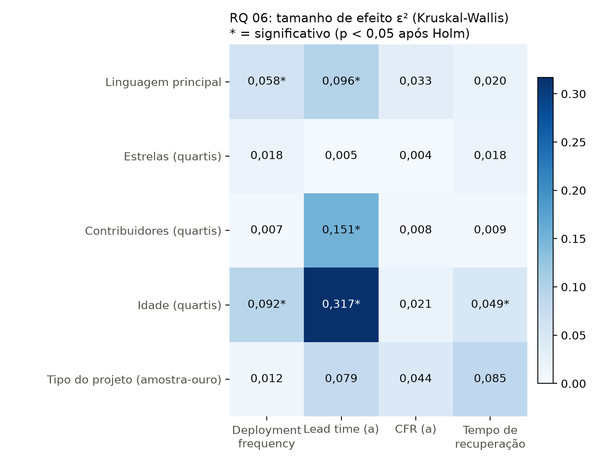

# Resultados: RQ 06

Gerado por `python -m analysis.fatores` a partir de `repositories_metrics.csv` (383 repositórios). 20 testes; p-valores corrigidos por Holm; α = 0,05.

## Testes por fator × métrica

| Fator | Métrica | Teste | n | Estatística | p | p (Holm) | Efeito | δ (Q4 × Q1) |
|---|---|---|---:|---:|---:|---:|---|---:|
| Linguagem principal | Deployment frequency | Kruskal-Wallis | 383 | H = 22,12 | < 0,001 | **0,008** | ε² = 0,058 (pequeno) | – |
| Linguagem principal | Lead time (a) | Kruskal-Wallis | 383 | H = 36,57 | < 0,001 | **< 0,001** | ε² = 0,096 (médio) | – |
| Linguagem principal | CFR (a) | Kruskal-Wallis | 383 | H = 12,57 | 0,028 | 0,388 | ε² = 0,033 (pequeno) | – |
| Linguagem principal | Tempo de recuperação | Kruskal-Wallis | 364 | H = 7,19 | 0,207 | 1,000 | ε² = 0,020 (pequeno) | – |
| Estrelas (quartis) | Deployment frequency | Kruskal-Wallis | 383 | H = 6,70 | 0,082 | 0,986 | ε² = 0,018 (pequeno) | 0,206 |
| Estrelas (quartis) | Lead time (a) | Kruskal-Wallis | 383 | H = 1,86 | 0,602 | 1,000 | ε² = 0,005 (desprezível) | -0,104 |
| Estrelas (quartis) | CFR (a) | Kruskal-Wallis | 383 | H = 1,57 | 0,667 | 1,000 | ε² = 0,004 (desprezível) | 0,066 |
| Estrelas (quartis) | Tempo de recuperação | Kruskal-Wallis | 364 | H = 6,70 | 0,082 | 0,986 | ε² = 0,018 (pequeno) | -0,016 |
| Contribuidores (quartis) | Deployment frequency | Kruskal-Wallis | 383 | H = 2,67 | 0,446 | 1,000 | ε² = 0,007 (desprezível) | 0,134 |
| Contribuidores (quartis) | Lead time (a) | Kruskal-Wallis | 383 | H = 57,77 | < 0,001 | **< 0,001** | ε² = 0,151 (médio) | 0,587 |
| Contribuidores (quartis) | CFR (a) | Kruskal-Wallis | 383 | H = 3,09 | 0,379 | 1,000 | ε² = 0,008 (desprezível) | 0,108 |
| Contribuidores (quartis) | Tempo de recuperação | Kruskal-Wallis | 364 | H = 3,33 | 0,343 | 1,000 | ε² = 0,009 (desprezível) | 0,101 |
| Idade (quartis) | Deployment frequency | Kruskal-Wallis | 383 | H = 35,23 | < 0,001 | **< 0,001** | ε² = 0,092 (médio) | -0,441 |
| Idade (quartis) | Lead time (a) | Kruskal-Wallis | 383 | H = 121,04 | < 0,001 | **< 0,001** | ε² = 0,317 (grande) | 0,800 |
| Idade (quartis) | CFR (a) | Kruskal-Wallis | 383 | H = 7,92 | 0,048 | 0,621 | ε² = 0,021 (pequeno) | -0,194 |
| Idade (quartis) | Tempo de recuperação | Kruskal-Wallis | 364 | H = 17,84 | < 0,001 | **0,008** | ε² = 0,049 (pequeno) | 0,321 |
| Tipo do projeto (amostra-ouro) | Deployment frequency | Kruskal-Wallis | 60 | H = 0,70 | 0,874 | 1,000 | ε² = 0,012 (pequeno) | – |
| Tipo do projeto (amostra-ouro) | Lead time (a) | Kruskal-Wallis | 60 | H = 4,68 | 0,197 | 1,000 | ε² = 0,079 (pequeno) | – |
| Tipo do projeto (amostra-ouro) | CFR (a) | Kruskal-Wallis | 60 | H = 2,62 | 0,454 | 1,000 | ε² = 0,044 (pequeno) | – |
| Tipo do projeto (amostra-ouro) | Tempo de recuperação | Kruskal-Wallis | 58 | H = 4,83 | 0,184 | 1,000 | ε² = 0,085 (médio) | – |

## Medianas por grupo

**Linguagem principal**

| Métrica | TypeScript | Python | Go | Rust | JavaScript | Outras |
|---|---:|---:|---:|---:|---:|---:|
| n | 111 | 84 | 44 | 41 | 32 | 71 |
| Deployment frequency | 0,77 | 0,61 | 0,39 | 0,40 | 0,37 | 0,36 |
| Lead time (a) | 8,07 | 6,94 | 24,65 | 8,09 | 13,73 | 24,62 |
| CFR (a) | 6,0% | 4,1% | 4,5% | 6,8% | 3,2% | 4,4% |
| Tempo de recuperação | 2,20 | 2,18 | 3,48 | 3,45 | 2,66 | 3,52 |

**Estrelas (quartis)**

| Métrica | Q1 | Q2 | Q3 | Q4 |
|---|---:|---:|---:|---:|
| n | 96 | 96 | 95 | 96 |
| Deployment frequency | 0,38 | 0,46 | 0,52 | 0,71 |
| Lead time (a) | 11,58 | 11,32 | 14,97 | 8,96 |
| CFR (a) | 5,4% | 4,3% | 4,8% | 5,4% |
| Tempo de recuperação | 2,71 | 2,21 | 3,18 | 2,79 |

**Contribuidores (quartis)**

| Métrica | Q1 | Q2 | Q3 | Q4 |
|---|---:|---:|---:|---:|
| n | 96 | 96 | 96 | 95 |
| Deployment frequency | 0,44 | 0,49 | 0,53 | 0,52 |
| Lead time (a) | 5,53 | 9,45 | 9,72 | 32,11 |
| CFR (a) | 4,6% | 4,4% | 4,5% | 5,7% |
| Tempo de recuperação | 1,77 | 2,62 | 3,12 | 2,71 |

**Idade (quartis)**

| Métrica | Q1 | Q2 | Q3 | Q4 |
|---|---:|---:|---:|---:|
| n | 96 | 96 | 95 | 96 |
| Deployment frequency | 0,88 | 0,61 | 0,35 | 0,36 |
| Lead time (a) | 2,86 | 8,72 | 16,53 | 42,33 |
| CFR (a) | 6,1% | 5,7% | 4,2% | 4,1% |
| Tempo de recuperação | 1,53 | 2,51 | 3,52 | 3,33 |

**Tipo do projeto (amostra-ouro)**

| Métrica | aplicacao | biblioteca | cli | outro |
|---|---:|---:|---:|---:|
| n | 25 | 18 | 14 | 3 |
| Deployment frequency | 0,50 | 0,42 | 0,48 | 0,46 |
| Lead time (a) | 9,15 | 15,35 | 12,05 | 0,84 |
| CFR (a) | 4,8% | 4,6% | 3,8% | 11,1% |
| Tempo de recuperação | 1,47 | 2,88 | 1,10 | 0,65 |

## Comparações par a par (só nos testes significativos)

| Fator | Métrica | Grupos | Medianas | p (Holm) | δ |
|---|---|---|---|---:|---|
| linguagem | Deployment frequency | TypeScript × Go | 0,77 × 0,39 | 0,039 | 0,309 (pequeno) |
| linguagem | Deployment frequency | TypeScript × JavaScript | 0,77 × 0,37 | 0,045 | 0,340 (médio) |
| linguagem | Deployment frequency | TypeScript × Outras | 0,77 × 0,36 | < 0,001 | 0,368 (médio) |
| linguagem | Lead time (a) | TypeScript × Go | 8,07 × 24,65 | 0,020 | -0,324 (pequeno) |
| linguagem | Lead time (a) | TypeScript × Outras | 8,07 × 24,62 | < 0,001 | -0,442 (médio) |
| linguagem | Lead time (a) | Python × Go | 6,94 × 24,65 | 0,046 | -0,309 (pequeno) |
| linguagem | Lead time (a) | Python × Outras | 6,94 × 24,62 | < 0,001 | -0,437 (médio) |
| linguagem | Lead time (a) | Rust × Outras | 8,09 × 24,62 | 0,015 | -0,370 (médio) |
| contribuidores | Lead time (a) | Q1 × Q3 | 5,53 × 9,72 | < 0,001 | -0,319 (pequeno) |
| contribuidores | Lead time (a) | Q1 × Q4 | 5,53 × 32,11 | < 0,001 | -0,587 (grande) |
| contribuidores | Lead time (a) | Q2 × Q4 | 9,45 × 32,11 | < 0,001 | -0,456 (médio) |
| contribuidores | Lead time (a) | Q3 × Q4 | 9,72 × 32,11 | < 0,001 | -0,328 (pequeno) |
| idade | Deployment frequency | Q1 × Q2 | 0,88 × 0,61 | 0,048 | 0,194 (pequeno) |
| idade | Deployment frequency | Q1 × Q3 | 0,88 × 0,35 | < 0,001 | 0,400 (médio) |
| idade | Deployment frequency | Q1 × Q4 | 0,88 × 0,36 | < 0,001 | 0,441 (médio) |
| idade | Deployment frequency | Q2 × Q3 | 0,61 × 0,35 | 0,048 | 0,202 (pequeno) |
| idade | Deployment frequency | Q2 × Q4 | 0,61 × 0,36 | 0,016 | 0,241 (pequeno) |
| idade | Lead time (a) | Q1 × Q2 | 2,86 × 8,72 | < 0,001 | -0,420 (médio) |
| idade | Lead time (a) | Q1 × Q3 | 2,86 × 16,53 | < 0,001 | -0,628 (grande) |
| idade | Lead time (a) | Q1 × Q4 | 2,86 × 42,33 | < 0,001 | -0,800 (grande) |
| idade | Lead time (a) | Q2 × Q3 | 8,72 × 16,53 | < 0,001 | -0,277 (pequeno) |
| idade | Lead time (a) | Q2 × Q4 | 8,72 × 42,33 | < 0,001 | -0,557 (grande) |
| idade | Lead time (a) | Q3 × Q4 | 16,53 × 42,33 | < 0,001 | -0,323 (pequeno) |
| idade | Tempo de recuperação | Q1 × Q3 | 1,53 × 3,52 | 0,001 | -0,310 (pequeno) |
| idade | Tempo de recuperação | Q1 × Q4 | 1,53 × 3,33 | 0,001 | -0,321 (pequeno) |

